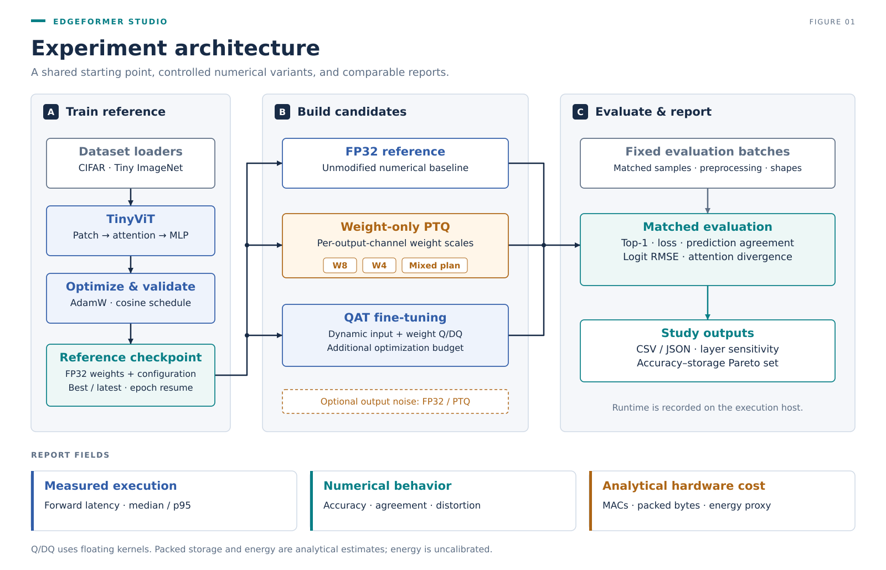
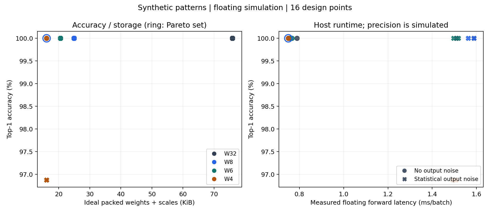
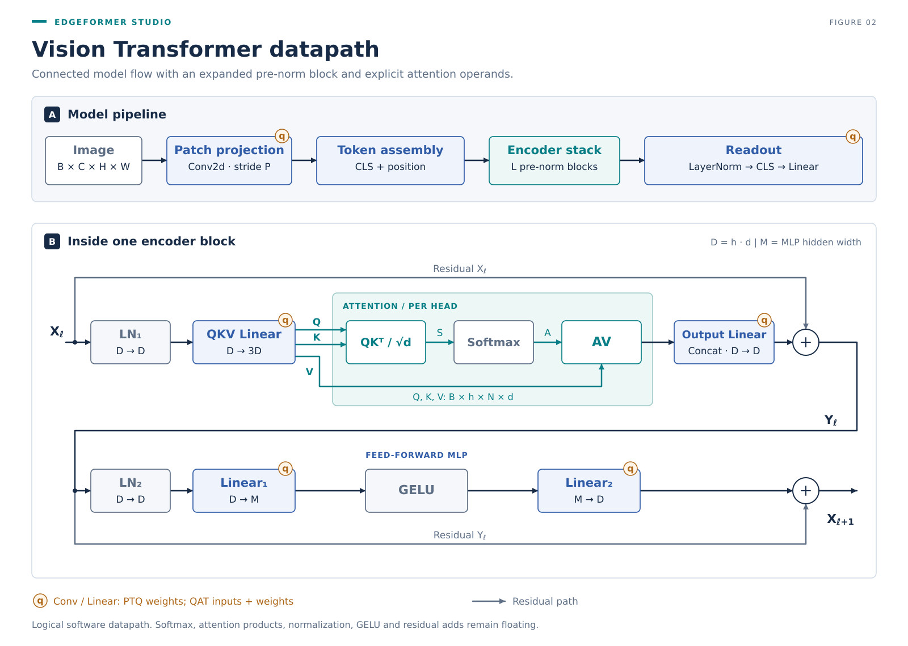

# EdgeFormer Studio

**Train a compact ViT. Study its precision. Find its sensitive layers. Report costs honestly.**


EdgeFormer Studio is a PyTorch toolkit for reproducible numerical and hardware-cost experiments on compact Vision Transformers. It connects training and validation to weight quantization, quantization-aware training, approximate-arithmetic sensitivity, attention inspection, and matched design comparisons.



> **What the precision labels mean:** W4/W8 PTQ and QAT simulate quantization using floating tensors and floating operator kernels. Packed storage and compute energy are analytical estimates. CPU/CUDA latency is measured execution time. These are separate kinds of evidence.

## What changed in v0.2

| Area | Improvement |
| --- | --- |
| QAT correctness | Straight-through gradients replace the zero gradient through rounding; Linear **and** patch Conv2d support dynamic input and per-channel weight fake quantization. |
| Precision experiments | Symmetric 2–16-bit weights, a 32-bit identity path, per-channel/per-tensor PTQ, and selective mixed-precision plans. Biases and normalization remain floating. |
| Attention | PyTorch SDPA by default; an explicit implementation for inspection and comparison; attention maps contain probabilities before dropout. |
| Training | Validation every epoch, AdamW, cosine learning rate, gradient clipping, best/latest checkpoints, CSV history, and epoch-boundary resume with optimizer, scheduler and RNG states. |
| Analysis | Fixed-batch precision/error sweeps, logit distortion, attention Jensen–Shannon divergence, prediction agreement, sensitivity ablations and an accuracy/storage Pareto set. |
| Profiling | Correct input-channel MAC counts; separate runtime and ideal packed storage; scale overhead; warmup, synchronized timings, median, p95 and throughput. |
| Usability | One CLI, optional dataset/demo dependencies, Windows-friendly commands, offline smoke workflow, four runnable notebooks and implementation-aligned diagrams. |
| Reliability | Numerical, gradient, checkpoint, dataset, profiling, CLI and resume regression tests; GitHub Actions configuration. |

See [CHANGELOG.md](CHANGELOG.md) for migration details and [docs/VALIDATION.md](docs/VALIDATION.md) for the checks actually run.

## Install

Extract this repository and open a terminal in the folder containing `pyproject.toml`.

```bash
python -m venv .venv
```

Windows PowerShell, without changing execution policy:

```powershell
.\.venv\Scripts\python.exe -m pip install --upgrade pip
.\.venv\Scripts\python.exe -m pip install -e ".[data,dev]"
.\.venv\Scripts\python.exe -m edgeformer --help
```

If you activate the environment, `python` in the remaining examples refers to that environment:

```powershell
.\.venv\Scripts\Activate.ps1
```

Linux/macOS:

```bash
source .venv/bin/activate
python -m pip install --upgrade pip
python -m pip install -e '.[data,dev]'
```

For model experiments and synthetic data only, install `python -m pip install -e .`. Real datasets require the `data` extra; the optional demo requires `python -m pip install -e '.[demo]'`. Install a matching PyTorch/torchvision build for your CPU or CUDA environment before the extras if needed; see [PyTorch installation](https://pytorch.org/get-started/locally/).

The commands below work as single lines in PowerShell, Bash and most VS Code terminals. You can replace `python` with `.\.venv\Scripts\python.exe` on Windows.

## Start here: no dataset download

```bash
python -m edgeformer train --config configs/smoke.yaml --output runs/smoke
python -m edgeformer evaluate --checkpoint runs/smoke/best.pt
python -m edgeformer benchmark --checkpoint runs/smoke/best.pt --bits 4 --runs 20
python -m pytest -q
```

This trains a 19,428-parameter model on four classes of synthetic image patterns. It verifies the workflow; the resulting accuracy says nothing about CIFAR or ImageNet.

To regenerate every bundled example, including FP32 training, W4 PTQ, W4 QAT, a 16-point sweep, attention inspection and sensitivity plots:

```bash
python scripts/reproduce_examples.py
```

Checkpoints go to `runs/example/`; reports go to `examples/results/`. Existing files in those two example locations are overwritten. [examples/README.md](examples/README.md) explains the outputs.

## Train and validate

```bash
python -m edgeformer train --config configs/cifar10.yaml --download --device auto --output runs/cifar10
python -m edgeformer train --config configs/cifar100.yaml --download --output runs/cifar100
```

The toolkit uses the CIFAR test partition as the per-epoch validation partition. For a final research evaluation, reserve an independent tuning split and avoid selecting experiments on the final test set. No CIFAR accuracy is claimed in this release.

`--download` explicitly allows a CIFAR download. Without it, missing data causes an error. `--device auto` chooses CUDA when available. CLI CPU intra-op threads default to one; use `--threads 4` to change this and retain that setting in runtime comparisons.

A run directory contains:

| File | Contents |
| --- | --- |
| `latest.pt` | Last completed epoch, model/configuration, transform metadata, optimizer, scheduler, RNG states, loader generator state and metric history. |
| `best.pt` | First checkpoint achieving the highest validation accuracy so far. |
| `history.csv` | Sample-weighted training/validation loss and accuracy, learning rate and sample counts. |
| `run.json` | Resolved configuration, environment, seed-related settings and synthetic-data flag. |

Resume the same schedule after an interruption:

```bash
python -m edgeformer train --resume runs/cifar10/latest.pt --output runs/cifar10
```

Resume preserves the original data, batch size, seed, QAT precision and cosine horizon. If the original command used `--max-batches`, pass the same value. Resume is at completed epoch boundaries; an interrupted partial epoch is replayed. CPU tests compare the final weights and histories of interrupted and uninterrupted FP32 and W4 QAT runs exactly. CUDA reproducibility still depends on the device, backend and selected kernels.

Start a new fine-tuning schedule with `--checkpoint`, rather than `--resume`:

```bash
python -m edgeformer train --checkpoint runs/cifar10/best.pt --epochs 10 --output runs/finetune
```

For a quick diagnostic, use `--epochs 1 --max-batches 2`. The batch limit affects both training and validation and is recorded in the run metadata.

### Tiny ImageNet

```bash
python -m edgeformer train --config configs/tiny_imagenet.yaml --data-dir data/tiny-imagenet-200 --output runs/tiny_imagenet
```

Provide the dataset locally. The loader accepts its original layout (`train/<wnid>/images/`, `val/images/`, `val/val_annotations.txt`) or class-organized `val/<wnid>/`. Train/validation class mappings must match. Images are resized to the configured model size and normalized with mean/std `(0.5, 0.5, 0.5)`.

## PTQ: simulate weight precision

Evaluate a weight-only quantized copy without changing the original checkpoint:

```bash
python -m edgeformer evaluate --checkpoint runs/cifar10/best.pt --bits 8 --output results/w8.json
python -m edgeformer evaluate --checkpoint runs/cifar10/best.pt --bits 4 --output results/w4.json
```

Save the simulated weights:

```bash
python -m edgeformer quantize --checkpoint runs/cifar10/best.pt --bits 4 --output checkpoints/cifar10_w4.pt
python -m edgeformer evaluate --checkpoint checkpoints/cifar10_w4.pt
```

The saved tensors are floating Q/DQ values, so this does **not** shrink the `.pt` file to packed 4-bit weights. Metadata records the bit width and scale scheme. A checkpoint already carrying PTQ/QAT precision should be evaluated without another `--bits` conversion.

Default PTQ uses one symmetric scale per Conv/Linear output channel. Add `--per-tensor` to `quantize` for one scale per weight tensor. Biases, activations, LayerNorm, CLS tokens and positional embeddings remain floating.

### Selective mixed precision

The JSON plan in [configs/mixed_precision.example.json](configs/mixed_precision.example.json) gives selected layers W8; the CLI bit width supplies the default for all other Conv/Linear weights:

```bash
python -m edgeformer quantize --checkpoint runs/cifar10/best.pt --bits 4 --plan configs/mixed_precision.example.json --output checkpoints/mixed.pt
python -m edgeformer evaluate --checkpoint checkpoints/mixed.pt
python -m edgeformer benchmark --checkpoint checkpoints/mixed.pt
```

Module paths are validated. This is a user-specified precision plan, not an automated mixed-precision search. Use sensitivity results to choose layers worth protecting.

## QAT: train with simulated quantization

```bash
python -m edgeformer train --checkpoint runs/cifar10/best.pt --qat-bits 4 --epochs 10 --output runs/cifar10_qat_w4
python -m edgeformer evaluate --checkpoint runs/cifar10_qat_w4/best.pt
```

QAT wraps both Linear layers and the patch Conv2d. It uses per-channel weight scales and a dynamic scale for each input tensor. The backward pass uses an identity straight-through surrogate through Q/DQ. The optimizer updates floating master weights. LayerNorm, softmax, QK/AV matrix products, biases and residual operations remain floating. Checkpoint loading reconstructs QAT wrappers automatically.

This is a transparent research simulator with dynamic input scales, not a calibrated deployment backend. See [docs/NUMERICS.md](docs/NUMERICS.md) for the numerical contract.

## Compare design points

```bash
python -m edgeformer sweep --checkpoint runs/cifar10/best.pt --bits 32 8 6 4 --noise-scales 0 0.01 --repeats 3 --max-batches 8 --output results/sweep.csv
```

Each candidate starts from the same floating reference. The workflow caches the chosen evaluation batches, uses matching inputs, and records:

- Top-1 accuracy, cross-entropy and evaluated sample count.
- Prediction agreement, logit MAE/RMSE and cosine similarity versus the reference.
- Attention probability MAE and Jensen–Shannon divergence on the **first evaluation image**, averaged over layers.
- Ideal packed parameter/scale bytes and actual runtime parameter bytes.
- Floating forward latency: median and p95 for the first evaluation batch.
- Accuracy/storage nondomination in `pareto_accuracy_storage`.

The outputs are CSV, JSON with metadata, and a two-panel PNG. Accuracy values in machine-readable files are fractions. JS divergence uses natural logarithms. Repeats use consecutive error-model seeds on fixed weights and evaluation batches; they are not independent training trials. Host latency is displayed separately from the accuracy/storage Pareto set.

Use a batch limit for large datasets: caching the full validation loader can consume substantial host memory. The parameter sweep covers precision and statistical noise; it does not retrain different model architectures.



### Find sensitive layers

```bash
python -m edgeformer sensitivity --checkpoint runs/cifar10/best.pt --bits 4 --max-batches 8 --output results/sensitivity.csv
```

This applies W4 to one Conv/Linear layer at a time, keeping every other layer floating. The CSV is sorted by logit RMSE and includes accuracy change and prediction agreement. Negative accuracy drop means the candidate improved on that particular evaluated subset. Small subsets are useful for screening, not for final conclusions.

### Approximate arithmetic sensitivity

```bash
python -m edgeformer evaluate --checkpoint runs/cifar10/best.pt --bits 8 --approximate --noise-scale 0.01 --seed 42
```

The optional error model adds zero-mean Gaussian noise to Linear outputs during evaluation. Its standard deviation is `noise_scale × mean(abs(output))`, with a small floor for zero outputs. It preserves training behavior and supports selected layers through the Python API. It is a statistical sensitivity model; it does not implement an approximate multiplier or predict circuit energy savings.

## Attention inspection

```bash
python -m edgeformer attention --checkpoint runs/cifar10/best.pt --output results/attention.png
```

The figure shows the first evaluation image, each block's head-mean CLS attention, and residual-aware attention rollout. These are inspection tools, not causal explanations of predictions.



The default `attention_backend: sdpa` uses PyTorch scaled dot-product attention. Set `attention_backend: manual` in the model configuration for explicit attention on all forwards. `return_attention=True` takes the explicit inspection path regardless of backend. Returned maps are normalized probabilities **before** dropout.

## Profiling and units

```bash
python -m edgeformer benchmark --checkpoint runs/cifar10/best.pt --bits 8 --batch-size 1 --warmup 10 --runs 100 --output results/benchmark.json
```

No checkpoint is needed to profile a seeded, untrained model:

```bash
python -m edgeformer benchmark --config configs/smoke.yaml --device cpu --runs 20
```

| Quantity | Definition and limits |
| --- | --- |
| MACs | Per image; patch Conv, QKV, QK, AV, output projection, MLP and classifier. One multiply-accumulate counts as one MAC. Nonlinear/elementwise operations are excluded. |
| Runtime parameter bytes | Actual parameter tensor sizes. PTQ/QAT simulation still stores floating tensors. This is not process RAM or peak CUDA allocation. |
| Ideal packed bytes | Hypothetical bit-packed Conv/Linear weights, floating remaining parameters and FP32 scale overhead; excludes alignment, operator metadata and activation buffers. |
| Attention storage | Analytical score/probability matrices versus row-sized buffers. This is not a measurement of SDPA workspace or an implemented streaming accelerator. |
| Latency | Synchronized forward-only wall time; excludes loading, preprocessing and transfers. JSON includes mean, median, p95, standard deviation, batch size, runs and throughput. |
| Compute-energy proxy | `MACs × pJ/MAC_INT8 × (bits/8)^2 / 1e9`, in mJ **per image**. An uncalibrated uniform arithmetic heuristic, excluding memory/nonlinear operations. No proxy is emitted for a mixed layer plan. |

The default model has **1,803,850 parameters** and **122,097,024 MACs per image** at 32×32 input, patch size 4, width 192, four blocks and three heads. These are analytical counts from this implementation, not benchmark accuracy or PPA results.

`attention` in the MAC report is an aggregate of QKV, QK, AV and output projection. Do not add that aggregate to its component fields again.

## Python API

```python
import torch
from edgeformer.models import TinyViT
from edgeformer.quantization import quantize_model_weights, prepare_qat
from edgeformer.approximate import replace_linear_with_approx
from edgeformer.profiling import estimate_vit_macs, storage_report

model = TinyViT(embed_dim=96, depth=2, num_heads=3).eval()
images = torch.randn(2, 3, 32, 32)
logits, attention = model(images, return_attention=True)

w4 = quantize_model_weights(model, bits=4, per_channel=True)
noisy_w4 = replace_linear_with_approx(w4, noise_scale=0.01, layers={"blocks.0.attn.qkv"})
qat = prepare_qat(model, bits=4).train()
print(estimate_vit_macs(model))
print(storage_report(w4, bits=4))
```

Transforms return independent copies and preserve device, dtype, parameter values where applicable, and module train/eval modes. Applying an error wrapper to a QAT/custom Linear raises an error instead of silently discarding its precision semantics.

## Notebooks and local demo

The four notebooks in [notebooks/](notebooks/) cover training, PTQ/QAT gradients, attention inspection and hardware-cost interpretation. Their default examples run offline; clear outputs are provided so local experiments remain identifiable.

For optional local image inference:

```bash
python -m pip install -e '.[demo]'
python demo/app.py --checkpoint runs/cifar10/best.pt
```

The demo requires an existing checkpoint, uses its configured image size, caches the model, and binds to localhost. It uses CIFAR-10 names only when checkpoint metadata identifies CIFAR-10; other datasets receive numeric class labels. It never silently substitutes an untrained model for a missing checkpoint.

## Repository map

| Path | Purpose |
| --- | --- |
| `edgeformer/models/` | Compact ViT, attention and MLP. |
| `edgeformer/quantization/` | Q/DQ functions, PTQ and QAT conversion. |
| `edgeformer/approximate/` | Statistical output-error models. |
| `edgeformer/analysis/` | Distortion metrics, nondomination and sensitivity ablations. |
| `edgeformer/profiling/` | MACs, memory, latency and compute-cost proxy. |
| `edgeformer/utils/` | Configurations, datasets, seeds, checkpoints and structured output. |
| `edgeformer/engine.py`, `cli.py` | Training/evaluation engine and CLI workflows. |
| `scripts/` | Compatibility entry points and reproducible examples/figures. |
| `configs/` | CIFAR-10/100, Tiny ImageNet, smoke and mixed-plan examples. |
| `assets/` | Editable SVG architecture/quantization figures and PNG previews. |
| `examples/results/` | Actual offline smoke reports and plots. |
| `tests/`, `.github/workflows/` | Regression suite and CI configuration. |
| `docs/` | Numerical contract, experiment guidance and validation evidence. |

Legacy `python scripts/train.py ...`, `evaluate.py`, `quantize.py`, `benchmark.py` and `compare_models.py` entry points remain available. Prefer `python -m edgeformer ...` or the installed `edgeformer` command.

## Development and next extensions

```bash
python -m ruff check .
python -m ruff format --check .
python -m pytest -q
```

Source-only diagram regeneration is `python scripts/generate_figures.py`; PNG previews can be regenerated with Inkscape. For experiment methodology, see [docs/EXPERIMENTS.md](docs/EXPERIMENTS.md).

Useful next extensions are deployment-backed INT8 kernels, observer-calibrated activation PTQ, measured RTL error distributions, hardware trace export, and technology-calibrated cost models. None is presented as implemented in this release.

## Credit and license

Created by **Matin Firoozbakht** ([matinfirooz](https://github.com/matinfirooz)). Distributed under the [MIT License](LICENSE).

```bibtex
@software{firoozbakht_edgeformer_2026,
  author = {Firoozbakht, Matin},
  title = {EdgeFormer Studio: Reproducible Hardware-Aware ViT Experiments},
  year = {2026},
  version = {0.2.0},
  url = {https://github.com/matinfirooz/EdgeFormer-Studio}
}
```
